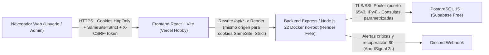

# SecureVault

Bóveda corporativa de información confidencial diseñada bajo arquitectura **Security-by-Design**, cumplimiento de **OWASP Top 10:2025** y restricción estricta de presupuesto **$0** (`Vercel Hobby + Render Free + Supabase Free + GitHub Free`).

---

## Arquitectura del Sistema



```text
+-------------------+      /api/* rewrite      +------------------------------+      SSL Pooler :6543      +----------------------+
|  React + Vite     | -----------------------> |  Express 5 (Docker node:22)  | -------------------------> |  PostgreSQL          |
|  Vercel Hobby     |   HttpOnly + X-CSRF      |  Render Free (USER node)     |   pg Pool + timeout 5s     |  Supabase Free       |
+-------------------+                          +------------------------------+                            +----------------------+
                                                              |
                                                              | Alertas críticas / recuperación $0
                                                              v
                                               +------------------------------+
                                               |  Discord Webhook (opcional)  |
                                               +------------------------------+
```

### Estructura del Monorepo

```text
.
├── .github/
│   ├── dependabot.yml              # Actualizaciones semanales npm + github-actions
│   └── workflows/ci.yml            # Gitleaks + npm audit + tests + Vite build
├── backend/
│   ├── Dockerfile                  # Multi-stage node:22-alpine (USER node)
│   ├── .dockerignore
│   ├── .env.example
│   ├── package.json
│   ├── scripts/seed-admin.js       # Bootstrap CLI seguro del primer administrador
│   ├── sql/init.sql                # Esquema relacional PostgreSQL idempotente
│   ├── src/
│   │   ├── app.js / server.js      # Núcleo Express endurecido y apagado ordenado
│   │   ├── config/                 # env.js (fail-closed), logger.js (Pino redact), db.js
│   │   ├── crypto/                 # Argon2id, AES-256-GCM (rotación), JWT HS256, CSRF
│   │   ├── middlewares/            # validate, rateLimiter (PostgreSQL), auth/RBAC/CSRF, errors
│   │   ├── routes/                 # health, auth, notes, admin
│   │   └── services/               # audit.service.js (Discord/DB), totp.service.js (2FA)
│   └── tests/                      # Suites nativas con node:test
├── frontend/
│   ├── index.html                  # CSP strict: sin CDNs externos
│   ├── vercel.json                 # Rewrites /api/* y cabeceras HTTP de seguridad
│   ├── vite.config.js              # Proxy /api en desarrollo local
│   └── src/                        # Cliente CSRF, AuthContext, Auth, Vault, Profile, Admin
└── render.yaml                     # Blueprint reproducible para Render Free
```

---

## Controles de Seguridad Implementados (OWASP Top 10:2025)

| Categoría OWASP | Controles aplicados en SecureVault |
| --- | --- |
| **A01 · Broken Access Control** | Control anti-IDOR en `GET/PUT/DELETE /api/notes/:id` verificando `owner_id` y auditando `IDOR_ATTEMPT_BLOCKED` (`403`). RBAC estricto con `requireAdmin` + `token_version` para revocación inmediata de sesiones. |
| **A02 · Security Misconfiguration** | `app.disable('x-powered-by')`, Helmet con CSP estricta (`default-src 'self'`, `object-src 'none'`, `frame-ancestors 'none'`), CORS restringido sin wildcard (`credentials: true`), validación **fail-closed** de variables de entorno con Zod (`process.exit(1)`), `.gitignore` estricto y cabeceras en `vercel.json`. |
| **A03 · Software Supply Chain Failures** | Instalaciones deterministas con `npm ci` (`--omit=dev` en Docker), `npm audit --audit-level=high` en CI, `dependabot.yml` semanal, escaneo de secretos en historial Git con **Gitleaks** en CI y cero CDNs externos en `frontend/index.html`. |
| **A04 · Cryptographic Failures** | Contraseñas con **Argon2id** (`memoryCost: 19456`, `timeCost: 2`, `parallelism: 1`) y hash dummy para mitigar enumeración por tiempo. Datos sensibles (notas, teléfonos, secretos TOTP) cifrados con **AES-256-GCM** e IV único de 12 bytes por operación. Tokens de recuperación con **SHA-256** (nunca en claro). Soporte de **rotación de llaves** (`key_version` + `POST /api/admin/rotate-keys`). |
| **A05 · Injection** | Consultas PostgreSQL 100% parametrizadas (`$1, $2, ...`), validación estricta de entrada con Zod (body, params, query) y renderizado exclusivo mediante interpolación segura de React (cero `dangerouslySetInnerHTML`). |
| **A06 · Insecure Design** | Límites de negocio para proteger almacenamiento gratuito: máximo 50 notas por usuario (transacción con bloqueo `FOR UPDATE`), título ≤ 150, contenido ≤ 10,000, máximo 10 etiquetas y categorías cerradas. Flujo `forgot-password` sin enumeración de usuarios. |
| **A07 · Authentication Failures** | Bloqueo progresivo tras 5 intentos fallidos durante 15 minutos (`BRUTE_FORCE_LOCKOUT`), cookies `HttpOnly` + `SameSite=Strict` + `Secure` en producción, rate limiting persistente en PostgreSQL (`pgRateLimiter`) y **MFA TOTP (2FA)** con QR y clave manual. |
| **A08 · Software or Data Integrity Failures** | JWT firmado exclusivamente con `HS256` rechazando explícitamente `alg: 'none'` y verificando firmas en tiempo constante (`timingSafeEqual`). Protección CSRF mediante Double-Submit Cookie (`sv_csrf` + `X-CSRF-Token`) ligada con HMAC a `${userId}:${token_version}`. |
| **A09 · Security Logging and Alerting** | Logger estructurado JSON con Pino y `redact` estricto sobre contraseñas, tokens, cookies y contenido cifrado; bitácora persistente en `security_logs` y alertas en tiempo real hacia Discord Webhooks. |
| **A10 · Mishandling of Exceptional Conditions** | `statement_timeout: 5000` en el pool de PostgreSQL, `globalErrorHandler` con respuestas genéricas HTTP `500` sin filtrar stack traces, manejo de `unhandledRejection` / `uncaughtException` y apagado ordenado. |

### Bonificaciones Implementadas
- **MFA TOTP (2FA)** completo (`setup` con QR + verificación con ventana ±30s + segundo paso en login).
- **Rotación de Llaves Criptográficas sin Pérdida de Datos** (`POST /api/admin/rotate-keys` en transacción atómica).
- **Contenedor Docker Hardened sin usuario root** (`node:22-alpine` multi-stage, `USER node`, `HEALTHCHECK`).
- **Pipeline DevSecOps con Gitleaks** en GitHub Actions sin licencias externas.

---

## Variables de Entorno Requeridas

> Nunca subas archivos `.env` ni secretos reales al repositorio. Consulta las plantillas `backend/.env.example` y `frontend/.env.example`.

### Backend (`backend/.env`)

| Variable | Obligatoria | Descripción |
| --- | --- | --- |
| `NODE_ENV` | Sí | Entorno de ejecución (`development`, `test` o `production`). |
| `PORT` | Sí | Puerto HTTP del servidor Express (por defecto `4000`). |
| `CORS_ORIGIN` | Sí | Origen(es) `http://` o `https://` permitidos para CORS (sin `*`). |
| `DATABASE_URL` | Sí | Cadena de conexión PostgreSQL (`postgresql://...`). |
| `DB_SSL` | Sí | Activa SSL hacia PostgreSQL (`false` en local sin SSL, `true` en Supabase). |
| `JWT_ACCESS_SECRET` | Sí | Secreto HMAC-SHA256 para JWT (mínimo 64 caracteres / 32 bytes hex). |
| `CSRF_SECRET` | Sí | Secreto HMAC-SHA256 para tokens CSRF (mínimo 64 caracteres / 32 bytes hex). |
| `ACTIVE_KEY_VERSION` | Sí | Versión numérica activa de la clave AES-256-GCM (ej. `1`). |
| `DATA_ENCRYPTION_KEY_V1` | Sí | Clave de cifrado versión 1 en Base64 (exactamente 32 bytes decodificados). |
| `DATA_ENCRYPTION_KEY_V<n>` | Opcional | Claves adicionales para rotación (cada `DATA_ENCRYPTION_KEY_V<n>` debe medir 32 bytes Base64). |
| `DISCORD_WEBHOOK_URL` | Opcional | URL `https://` de Discord Webhook para alertas críticas y recuperación `$0`. |
| `ADMIN_EMAIL` | Solo seed | Correo del administrador inicial usado por `npm run seed:admin`. |
| `ADMIN_PASSWORD` | Solo seed | Contraseña del administrador (política fuerte) usada por `npm run seed:admin`. |
| `ADMIN_FULL_NAME` | Solo seed | Nombre completo del administrador inicial. |
| `ADMIN_COMPANY` | Solo seed | Empresa del administrador inicial. |
| `ADMIN_PHONE` | Solo seed | Teléfono del administrador inicial (cifrado con AES-256-GCM). |

### Frontend (`frontend/.env`)

| Variable | Obligatoria | Descripción |
| --- | --- | --- |
| `VITE_API_BASE_URL` | Sí | Ruta base de la API (`/api` para usar proxy de Vite en local o rewrites de Vercel en producción). |

---

## Instalación y Ejecución Local

### 1. Preparar la base de datos PostgreSQL
Ejecuta el esquema idempotente en tu instancia local de PostgreSQL o Supabase:
```bash
psql "$DATABASE_URL" -f backend/sql/init.sql
```

### 2. Configurar variables de entorno locales
Copia las plantillas `.env.example` en `backend/.env` y `frontend/.env`. Para generar secretos aleatorios seguros en `backend/.env`:
```bash
node -e "const c = require('node:crypto'); console.log('JWT_ACCESS_SECRET=' + c.randomBytes(32).toString('hex')); console.log('CSRF_SECRET=' + c.randomBytes(32).toString('hex')); console.log('DATA_ENCRYPTION_KEY_V1=' + c.randomBytes(32).toString('base64'));"
```

### 3. Instalar dependencias y crear el primer administrador
```bash
cd backend
npm ci
```
En PowerShell (definiendo las variables temporales de bootstrap sin guardarlas en archivos):
```powershell
$env:ADMIN_EMAIL="admin@tu-empresa.com"
$env:ADMIN_PASSWORD="<reemplazar-por-password-fuerte>"
$env:ADMIN_FULL_NAME="Administrador Principal"
$env:ADMIN_COMPANY="SecureVault Corp"
$env:ADMIN_PHONE="+52 55 0000 0000"
npm run seed:admin
```

### 4. Ejecutar pruebas y levantar servicios
Backend (`http://localhost:4000`):
```bash
cd backend
npm test
npm run dev
```

Frontend (`http://localhost:5173`):
```bash
cd frontend
npm ci
npm run build
npm run dev
```

---

## Guía Reproducible de Despliegue a Producción ($0)

### Paso 1: Base de datos en Supabase Free
1. Crea un proyecto nuevo en [Supabase](https://supabase.com) (plan Free).
2. Abre el **SQL Editor**, pega el contenido completo de `backend/sql/init.sql` y ejecútalo.
3. Ve a **Project Settings -> Database -> Connection string -> URI** y selecciona **Transaction Pooler (puerto `6543`, compatible con IPv4 para Render Free)** asegurando `?sslmode=require` al final de la cadena.

### Paso 2: Backend Docker en Render Free
1. Crea un **Web Service** en [Render](https://render.com) conectado a tu repositorio de GitHub (puedes importar directamente `render.yaml`).
2. Verifica la configuración:
   - **Environment / Runtime**: `Docker`
   - **Dockerfile Path**: `./backend/Dockerfile`
   - **Docker Context**: `./backend`
   - **Plan**: `Free`
   - **Health Check Path**: `/health`
3. En **Environment Variables** del dashboard de Render, define:
   - `NODE_ENV=production`
   - `PORT=4000`
   - `DB_SSL=true`
   - `ACTIVE_KEY_VERSION=1`
   - `DATABASE_URL` (URI del Pooler de Supabase puerto `6543`)
   - `JWT_ACCESS_SECRET` (64 hex aleatorios distintos a desarrollo)
   - `CSRF_SECRET` (64 hex aleatorios distintos a desarrollo)
   - `DATA_ENCRYPTION_KEY_V1` (32 bytes Base64 aleatorios distintos a desarrollo)
   - `CORS_ORIGIN` (URL de tu app en Vercel, ej. `https://tu-proyecto.vercel.app`)
   - `DISCORD_WEBHOOK_URL` (opcional, webhook de Discord para alertas)
4. Ejecuta el bootstrap del administrador inicial desde tu equipo apuntando temporalmente `DATABASE_URL` hacia la cadena de Supabase (el plan Free de Render no incluye shell SSH interactiva) y usando la misma `DATA_ENCRYPTION_KEY_V1` configurada en Render.

### Paso 3: Frontend en Vercel Hobby
1. Actualiza la URL real de tu servicio en Render dentro de `frontend/vercel.json`:
   ```json
   {
     "source": "/api/:path*",
     "destination": "https://TU-SERVICIO-EN-RENDER.onrender.com/api/:path*"
   }
   ```
2. Sube el cambio a GitHub y crea un proyecto en [Vercel](https://vercel.com) (plan Hobby).
3. Configura **Root Directory** como `frontend`, framework **Vite** y variable de entorno `VITE_API_BASE_URL=/api`.
4. Despliega. Las peticiones a `/api/*` se reescribirán internamente hacia Render manteniendo el mismo origen para las cookies `HttpOnly` + `SameSite=Strict` sin costo de dominio personalizado.
